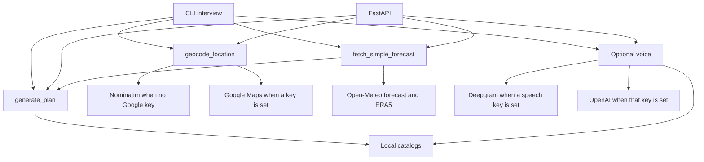
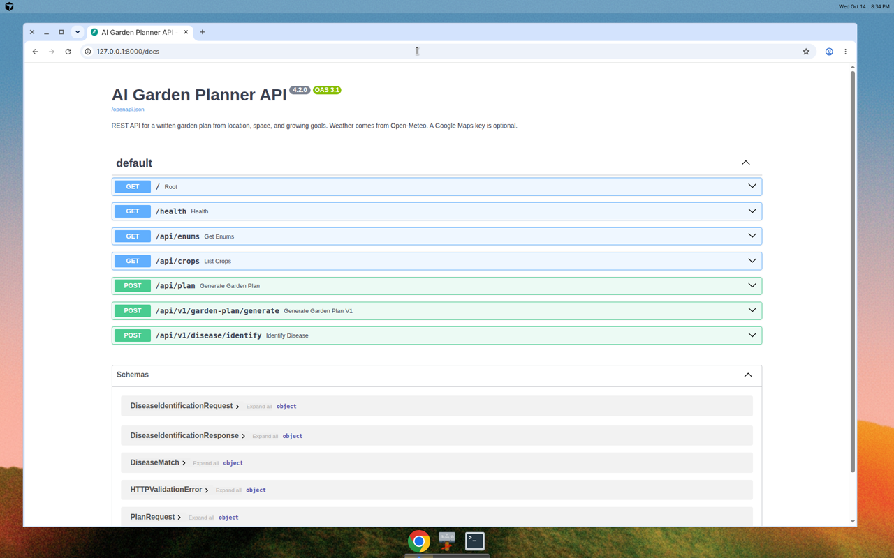
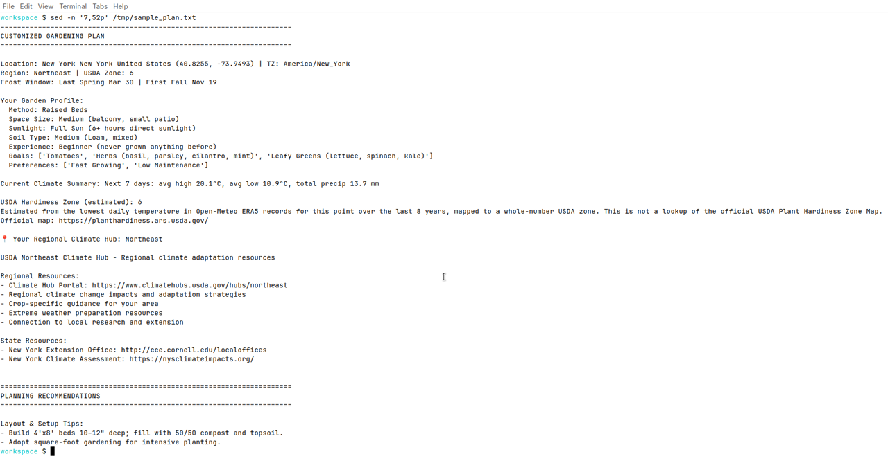

# Ask Jane

Ask Jane is the garden planner for [Saved by the Plate](https://savedbytheplate.org), a food-justice education nonprofit. This repository is the planner on its own: a Python library, an interactive command-line interview, and a FastAPI service. It was developed separately from the organization's site.

A plan is plain text. You give a location and a growing profile. Ask Jane combines that profile with a short weather forecast and the catalogs in this repository, then writes crop ideas, a bed sketch, watering notes, companions, care, and learning links.

The service version string in `api.py` is 4.2.0.

## What you get

`generate_plan` in `agi_agent/gardening/planner.py` assembles one document:

- Resolved place, coordinates, and timezone
- An estimated USDA hardiness zone and a typical last-spring / first-fall frost window
- A 7-day temperature and precipitation summary
- Layout tips for the method, space, and light you chose
- Up to 20 crop suggestions, with planting months and days to harvest when the timing catalog has that crop
- Yield notes, companion notes, and an ASCII bed layout
- Variety notes for suggested crops that have variety records
- A planting calendar and a care schedule
- An irrigation note when a soil type is set, from a local water-balance calculation on that 7-day forecast (Hargreaves-style reference evapotranspiration, following the shape of the [Cornell Climate Smart Farming water-deficit calculator](https://climatesmartfarming.org/tools/csf-water-deficit-calculator/))
- Succession-planting and cover-crop windows
- A 4-year rotation sketch, plus soil, care, maintenance, fertilization, and pruning notes
- Troubleshooting notes, common mistakes, and tips for the current season
- Disease-prevention notes for the suggested crops
- Regional climate-hub links, static future-climate tables for US regions, and stored assessment blurbs for New York and California
- Learning links filtered toward the stated experience level

Two optional inputs change the text when they are present:

- A local image path, used by the CLI, is reduced to brightness, a green-pixel share, and an edge-density estimate (`agi_agent/gardening/vision.py`).
- Air quality, solar, pollen, elevation, and aerial fields are summarized when the caller sends them. This service does not request those feeds itself.

The interview asks for location (address or coordinates), method, space, sunlight, experience, soil, crop interests, preferences, notes, and an optional image path. Methods include raised beds, containers, in-ground, vertical, indoor, rooftop, and hydroponic.

## Catalogs checked into this repository

These are the sizes of the Python catalogs, counted from the modules. They are not live external databases.

| Catalog | What it holds |
| --- | --- |
| `GET /api/crops` | 334 entries on a local run: 100 with variety records, 234 further names from the family catalog |
| `CROP_FAMILIES` | 298 crop keys in 21 botanical families |
| `VARIETY_DATABASE` | 100 crops, 108 variety records |
| `CROP_TIMING_DATABASE` | 289 crops |
| `COMPANION_DATABASE` | 160 crops, 578 listed companions and 210 listed plants to separate |
| `DISEASE_DATABASE` | 50 records across 17 crops (31 distinct names) |
| `FAMILY_DISEASES` | 400 family-level disease strings (311 unique), used by symptom matching |
| `RESOURCES_DATABASE` | 58 learning resources |
| `PLANTS` | 13 hand-written profiles that the recommender filters first |

Further suggestions are built from the family catalog. `recommend_plants` returns at most 20 names.

## Stack

- Python. `runtime.txt` asks for 3.11. The checks below also ran on 3.12.
- FastAPI 0.104.1, Uvicorn 0.24.0, Pydantic 2.5.0
- `requests`, `python-dotenv`, and `python-multipart` (multipart is what the voice upload and speak forms use)
- NumPy and Pillow, for the optional image estimate
- pandas is listed in `requirements.txt`. The planner modules do not import it.
- [Open-Meteo](https://open-meteo.com/) forecast and ERA5 archive, both key-free
- [OpenStreetMap Nominatim](https://nominatim.org/) for addresses when `GOOGLE_MAPS_API_KEY` is empty
- Google Maps Geocoding when that key is set

`agi_agent/core/agent.py` defines `AGIAgent`, an in-memory placeholder with a canned reply. The CLI imports that class and does not call it. Planning stays in `generate_plan`.

Deepgram and OpenAI are not imported at startup. `agi_agent/gardening/voice.py` imports them only inside a speech or model call, and only when the matching key is set.

## Architecture



`api.py` exposes:

| Method | Path | Role |
| --- | --- | --- |
| GET | `/` | Service name, version, and endpoint list |
| GET | `/health` | Health check |
| GET | `/api/enums` | Form choices |
| GET | `/api/crops` | Crop catalog |
| POST | `/api/plan` | Garden plan |
| POST | `/api/v1/garden-plan/generate` | Same plan handler |
| POST | `/api/v1/disease/identify` | Symptom and crop-family match |
| GET | `/api/voice/status` | Whether speech and OpenAI keys are set |
| POST | `/api/voice/ask` | Text or audio question; audio out only when speech is on |
| POST | `/api/voice/upload` | Audio file question; 503 when speech is off |
| POST | `/api/voice/speak` | Text to speech; 503 when speech is off |
| POST | `/api/voice/garden-plan` | Plan from a short description; speech optional |
| GET | `/docs` | Interactive API docs |

Disease matching compares the crop family and the words you send with a local keyword list. Image fields are accepted on the request and left unused.

## Setup

```bash
python3 -m venv .venv
source .venv/bin/activate
pip install -r requirements.txt
```

Generate a New York plan with coordinates, so no geocoding key is required:

```bash
python generate_sample_plan.py
```

Interactive interview:

```bash
python -m agi_agent.cli
```

An editable install also adds a `agi-agent` command (`pip install -e .`).

API, with docs at [http://127.0.0.1:8000/docs](http://127.0.0.1:8000/docs):

```bash
python -m uvicorn api:app --host 127.0.0.1 --port 8000
```

Copy `.env.example` to `.env` only if you want to set something. Every name in the example is blank.

| Name | Role |
| --- | --- |
| `GOOGLE_MAPS_API_KEY` | Optional. Empty uses Nominatim for addresses and reverse lookup. |
| `PORT` | Port used when you start the API with `python api.py`. Uvicorn's `--port` flag overrides this. |
| `DEEPGRAM_API_KEY` | Optional. Empty disables speech-to-text and text-to-speech. |
| `OPENAI_API_KEY` | Optional. Empty answers questions from the local catalogs. |

`.env` is gitignored. A forecast for coordinates works with both variables empty. Address lookup then uses Nominatim, which expects a identifiable User-Agent and light traffic.

Example plan request:

```bash
curl -s -X POST http://127.0.0.1:8000/api/v1/garden-plan/generate \
  -H 'Content-Type: application/json' \
  -d '{
    "address": "New York, NY",
    "method": "Raised Beds",
    "size": "Medium (balcony, small patio)",
    "experience": "Beginner (never grown anything before)",
    "crop_interests": ["Tomatoes", "Herbs (basil, parsley, cilantro, mint)"],
    "preferences": ["Low Maintenance"],
    "soil_type": "Medium (Loam, mixed)"
  }'
```

## Voice

Voice is optional. With `DEEPGRAM_API_KEY` and `OPENAI_API_KEY` empty, the interview, the plan routes, and text questions still run. Routes that need audio (`/api/voice/speak`, `/api/voice/upload`, and `/api/voice/ask` when the body is only audio) respond with HTTP 503 and the message that voice is disabled. They do not import Deepgram and they do not raise a traceback.

`GET /health` and `GET /api/voice/status` report `voice: disabled` in that case. Health does not call Deepgram. It only checks that the key is non-empty.

Text questions use the timing, companion, care, and disease catalogs in this repository. A season question such as "What vegetables should I plant in spring?" lists crops whose planting season is spring. When `OPENAI_API_KEY` is set and the `openai` package is installed, the same route asks `gpt-3.5-turbo` first and falls back to the catalogs if that call fails. `OPENAI_MODEL` overrides the model name. It is not required, and it is not listed in `.env.example`.

Spoken audio uses Deepgram: Nova-3 for transcription and Aura (`aura-asteria-en`) for speech, which is the client shape from `feature/voice-integration`. If the installed `deepgram-sdk` is the older 3.x line, the same functions call `listen.prerecorded` and `speak.v("1").stream` instead. Install the clients only if you set the keys:

```bash
pip install -e '.[voice]'
```

One question from the command line, with no speech key:

```bash
python -m agi_agent.cli --status
python -m agi_agent.cli --ask "What vegetables should I plant in spring?"
```

`--voice` speaks the answer when the Deepgram key is set. Without the key it prints the disabled message and still prints the text. `--transcribe path` needs the key; without it the process exits 2 and does not start the interview. The interview itself is unchanged: `python -m agi_agent.cli` with no flags.

A text question against the API:

```bash
curl -s -X POST http://127.0.0.1:8000/api/voice/ask \
  -H 'Content-Type: application/json' \
  -d '{"text_question": "What vegetables should I plant in spring?", "location": "New York, NY"}'
```

The JSON includes `answer_text`, `speech_enabled: false`, and `audio_base64: null` when no speech key is set. A spoken plan summary is the same idea: send `text` and `address` as form fields to `POST /api/voice/garden-plan`. The full plan is the written `generate_plan` document. Audio, when speech is on, is only the short summary. Unstated method, size, light, and experience become raised beds, medium, full sun, and beginner. Crop words in the sentence select interests; otherwise the plan uses the suggest option.

## Local run

Interactive docs from this machine, with the API listening on port 8000:



The opening of a plan for New York, produced by `python generate_sample_plan.py` with no API key:



## Project layout

```
api.py                          FastAPI app
generate_sample_plan.py         One New York plan, no prompts
agi_agent/cli.py                Interactive interview
agi_agent/core/agent.py         Unused in-memory placeholder
agi_agent/gardening/planner.py  Plan assembly
agi_agent/gardening/voice.py    Optional speech and catalog answers
agi_agent/gardening/climate.py  Geocoding, forecast, zone, frost window
agi_agent/gardening/knowledge.py
agi_agent/gardening/*.py        Catalogs and section writers
```

Scripts named `test_v3_*.py`, `test_v4_phase_2.py`, `test_layout_generator.py`, and `demo_water_management.py` print feature checks. They are not a pytest suite. `test_voice.py` is a unittest module for the optional voice paths, including the API with speech keys unset.

Older notes in the repository root (`CHANGELOG_v3*`, `V4_ROADMAP.md`, `CURRENT_STATUS.md`, and similar files) record development as it happened. Several of their counts and completion claims differ from the catalogs above. Use this README for what the code does today.

## Contributors

From the git history:

- **Shay Bouchles** ([shaythegay13](https://github.com/shaythegay13)) — author and primary developer
- **Sabih Sarowar** ([kleenkanteen](https://github.com/kleenkanteen)) — local development notes

## License

This repository does not include a `LICENSE` file.

## Limits of the current code

- Drought status is a fixed record: no drought, labeled as a placeholder. It does not read the US Drought Monitor.
- Coastal risk is a latitude/longitude box check. Flood zone is a fixed placeholder. Both modules say so in their docstrings.
- Future-climate figures are static tables in `future_climate.py`.
- The hardiness zone is the coldest daily low in about eight years of Open-Meteo ERA5 data, mapped to a whole USDA zone number. It is an estimate, separate from the [official Plant Hardiness Zone Map](https://planthardiness.ars.usda.gov/).
- `PlanRequest` accepts `growing_location`, `time_commitment`, and garden-image fields. Plan generation does not read them.
- CORS in `api.py` allows every origin and allows credentials.
- Speech is not a live session. Audio is a whole file or a base64 body, and the spoken reply is a whole clip. The health check does not contact Deepgram.
- Catalog answers are keyword lookups. They are shorter than a model reply, and a vague garden-plan sentence keeps the raised-bed defaults above.
- The voice garden-plan route does not pull a city out of the sentence unless `OPENAI_API_KEY` is set and the model returns one. Pass `address`, or latitude and longitude, the same way the other plan routes do.
